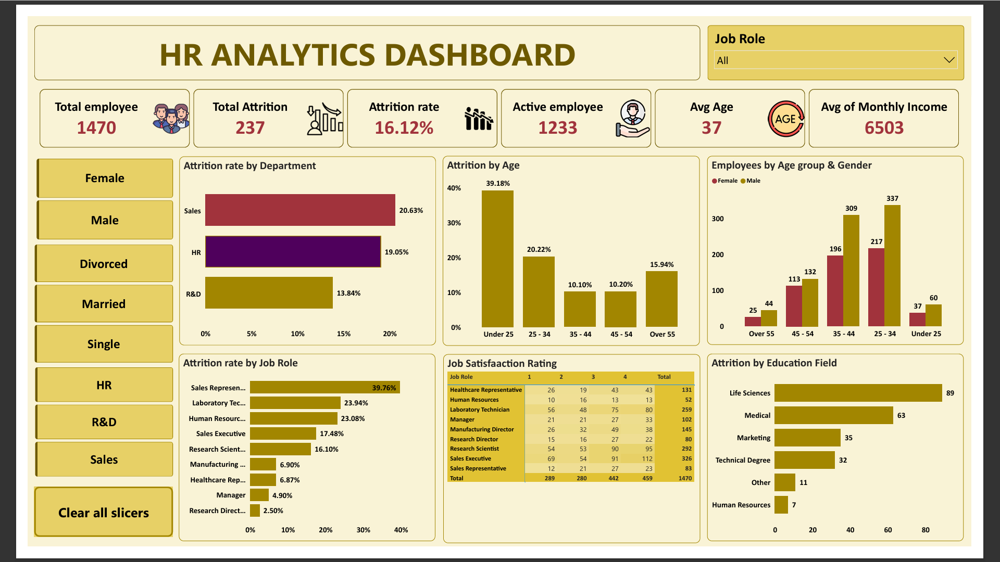

# HR Attrition Analysis | Power BI Dashboard

An interactive Power BI dashboard that analyzes employee attrition across departments, job roles, age groups and education fields, built on the IBM HR Analytics Employee Attrition dataset (Kaggle).

## Dashboard

## Tools
- Excel (data preparation and cleaning)
- Power BI (DAX measures, interactive slicers)
- MySQL (SQL analysis in `HR_Analytics_Dataset_analysis.sql`)

## Dataset
IBM HR Analytics Employee Attrition & Performance dataset (Kaggle): 1,470 employees and 35 columns covering demographics, job role, income, travel and attrition.

Source: [IBM HR Analytics Employee Attrition & Performance (Kaggle)](https://www.kaggle.com/datasets/pavansubhasht/ibm-hr-analytics-attrition-dataset)

## Key Metrics
| Metric | Value |
|---|---|
| Total employees | 1,470 |
| Total attrition | 237 |
| Attrition rate | 16.12% |
| Active employees | 1,233 |
| Average age | 37 |
| Average monthly income | 6,503 |

## Key Insights
1. **Overall:** 237 of 1,470 employees left, an attrition rate of 16.12%.
2. **Job role:** Sales Representatives have the highest attrition rate (39.76%), followed by Laboratory Technicians (23.94%) and Human Resources (23.08%). Research Directors have the lowest (2.50%).
3. **Department:** Sales has the highest attrition rate (20.63%), then HR (19.05%) and R&D (13.84%).
4. **Age:** Employees under 25 leave the most (39.18%), compared with about 10% for ages 35 to 54.
5. **Education field:** Life Sciences (89) and Medical (63) account for most leavers, the two largest employee groups.

## Recommendations
- Review compensation, workload and growth paths for Sales Representatives.
- Strengthen onboarding and mentoring for employees under 25.
- Run exit interviews in Sales and HR to find the specific reasons behind their higher attrition.

## Dashboard Features
- KPI cards: total employees, attrition, attrition rate, active employees, average age, average monthly income
- Slicers: gender, marital status, business travel, department, job role, with a Clear all slicers button
- Charts: attrition rate by department, age group and job role; employees by age group and gender; attrition by education field

## Files
- `HR_Analytics_analysis.pbix`: Power BI report
- `hr_analytics_dataset.csv`: dataset
- `HR_Analytics_Dataset_analysis.sql`: SQL analysis queries
- `HR_Analytics_Dashboard.png`: dashboard screenshot

## Author
Kuppam Kandriga Prasanth | Aspiring Data Analyst | Bengaluru, India
